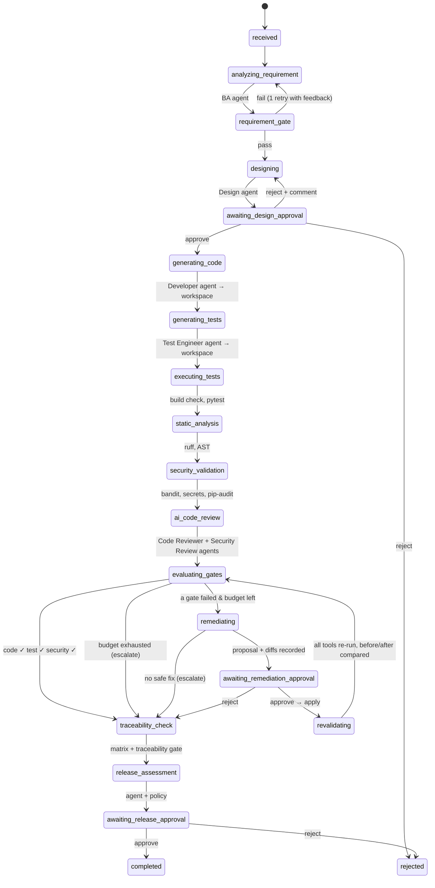

# Architecture

## 1. Principle

The system is built so that the mandatory engineering principle of the brief is enforced by
*code*, not by prompt wording:

| Layer | Responsibility | Can it mark code production-ready? |
|---|---|---|
| **Agents** (`app/agents`) | generate typed artifacts from the workflow state | no — they only return JSON |
| **Tools** (`app/tools`) | produce deterministic evidence (test results, lint, SAST, secrets, build) | no — they return `ToolRun`s and `Finding`s |
| **Gates + policy** (`app/orchestration/gates.py`) | turn evidence into pass/fail per gate and clamp the release recommendation | partially — they can *block*, never approve |
| **Humans** (`WorkflowEngine.approve`) | approve the design, each AI correction, the release | yes — the only path to `completed` |

The Release Assurance agent *recommends*; `GateEngine.apply_release_policy` can only make
that recommendation **less** optimistic (e.g. READY → CONDITIONAL when MEDIUM findings are
open, anything → NOT_READY when a mandatory gate failed or a HIGH/CRITICAL finding is open,
→ MANUAL_REVIEW when a human rejected a change or the remediation budget is exhausted).

## 2. Workflow state machine

Each handler in `WorkflowEngine` reads the state, calls exactly one kind of worker and returns
the next stage. The state is persisted after every transition, so a feature can be paused for
days at an approval checkpoint, resumed from another process, or inspected while running.
`run()` holds a per-feature lock so the API's background threads never execute the same
feature concurrently.

## 3. Agents

| # | Agent | Input | Output schema | Notes |
|---|---|---|---|---|
| 1 | Business Analyst | feature request (+ feedback) | `RequirementAnalysis` | FRs/NFRs, business rules, stories, Given/When/Then AC, assumptions, dependencies, questions, **ambiguities with proposed defaults** |
| 2 | Solution Design | approved requirements | `TechnicalDesign` | components ↔ requirement ids, component flow, API contract ↔ AC ids, data model, validation/error/logging/security, file plan |
| 3 | Developer | design + requirements | `CodeBundle` | full file contents; each file lists the requirement/AC ids it implements |
| 4 | Test Engineer | requirements, design, code | `TestBundle` | pytest files + explicit test ↔ AC mapping (also parsed from `AC:` docstrings) |
| 5 | Code Reviewer | implementation + tool results | `ReviewReport` | findings with Severity / Component / Finding / Evidence / Recommended fix |
| 6 | Security Review | implementation + scanner findings | `SecurityReport` | authn, authz, input validation, secrets, injection, deserialization, dependencies, logging, configuration |
| 7 | Defect Resolution | blocking findings + failed tool runs + history | `RemediationProposal` | complete replacement files; empty `changes` + low confidence ⇒ escalation |
| 8 | Release Assurance | gates, tools, findings, approvals, traceability | `ReleaseAssessment` | READY / CONDITIONAL / MANUAL_REVIEW / NOT_READY with evidence; policy-clamped |

All agents share `Agent.run()` which calls `LLMClient.generate()`; the client enforces the
schema (forced tool use on Anthropic, JSON mode elsewhere), retries once with the validation
errors, and emits an `agent_call` event per attempt.

## 4. Deterministic tools and the isolated workspace

`Workspace` (`app/tools/workspace.py`) gives every feature its own directory under
`SDLC_WORKSPACE_ROOT`. Generated files are path-checked (no absolute paths, no `..`), tools run
as subprocesses with `cwd` pinned to the workspace and a scrubbed environment, snapshots are
taken before every applied correction, and unified diffs are computed for each modification.

| Tool | Command | Gate check it feeds |
|---|---|---|
| build | `python -m compileall` + `python -c "import app.main"` | code.build_succeeds |
| pytest | `python -m pytest --junitxml …` (junit parsed, AC mapping attached) | test.* |
| ruff | `ruff check --isolated --select E,F,W,B,I --output-format json` | code.static_analysis_completed / no_critical_violations |
| ast | `ast.parse` structural checks (eval/exec, bare except, complexity, long functions, asserts) | code.no_critical_violations |
| bandit | `bandit -r app -f json` | security.* |
| secrets | regex detection of hard-coded credentials / keys / tokens | security.no_exposed_credentials |
| pip_audit | `pip-audit -r requirements.txt -f json` (optional) | security.no_blocking_security_findings |

Findings from every source share one schema. When a tool or agent re-runs, `_merge_findings`
reconciles: findings no longer detected become `resolved`, re-detected ones keep their id, new
ones are added — so "fixed" is always decided by the tools, never by the agent's claim.

## 5. Quality gates

`config/gates.yaml` → `GateEngine`. Every gate is a list of named checks over state; each check
returns pass/fail **and the evidence string** shown on the dashboard. Gates are evaluated with the
iteration number so the history of every re-evaluation is kept.

| Gate | Checks |
|---|---|
| requirement | acceptance criteria defined (every story, measurable) · ambiguities identified · mandatory NFR categories considered |
| code | build succeeds · static analysis completed · no critical violations |
| test | mandatory tests executed (≥ `minimum_tests`) · required tests pass · every AC has a test |
| security | no open blocking (HIGH/CRITICAL) security finding · no exposed credentials · required scanners completed |
| traceability | requirements → code · AC → tests · tests have execution results (thresholds configurable) |
| release | mandatory gates passed · no unresolved blocking defects · required human approvals recorded |

## 6. Traceability, observability, persistence

* **Traceability** (`app/orchestration/traceability.py`): for every requirement →
  stories → AC → design components → files (`implements` lists) → tests (test-bundle mapping ∪
  `AC:` docstrings) → execution outcomes, with coverage percentages and unmapped items.
* **Observability** (`app/observability.py`): `stage_transition`, `agent_call`, `tool_call`,
  `gate_evaluation`, `human_decision`, `ai_modification`, `policy_decision`, `error` events
  in SQLite; optional OpenTelemetry spans per stage.
* **Persistence** (`app/persistence.py`): the complete `WorkflowState` as JSON per feature plus
  the event table; the dashboard summary is aggregated from it.

## 7. Functional requirement coverage

| FR | Where |
|---|---|
| FR-01 Requirement intake | `POST /api/features`, `FeatureRequest` |
| FR-02 Requirement decomposition | Business Analyst agent |
| FR-03 Story generation | Business Analyst agent (`user_stories`, `acceptance_criteria`) |
| FR-04 Ambiguity detection | Business Analyst agent (`ambiguities`, `assumptions`); requirement gate |
| FR-05 Technical design | Solution Design agent |
| FR-06 Code generation | Developer agent (only after design approval) |
| FR-07 Test generation | Test Engineer agent, AC mapping |
| FR-08 Test execution | `tools/pytest_runner.py` |
| FR-09 Code review | Code Reviewer agent |
| FR-10 Static analysis | `tools/static_analysis.py` (ruff + AST) |
| FR-11 Security scanning | `tools/security_scanners.py` + Security Review agent |
| FR-12 Defect remediation | Defect Resolution agent, `ModificationRecord` diffs |
| FR-13 Revalidation | `revalidating` stage re-runs every tool (+ AI reviews) and compares snapshots |
| FR-14 Traceability | traceability matrix + gate |
| FR-15 Quality gates | `config/gates.yaml`, `GateEngine` |
| FR-16 Release assessment | Release Assurance agent + release policy |
| FR-17 Human control | approval checkpoints; AI corrections applied only after approval |
| FR-18 Observability | event log, OpenTelemetry, dashboard |

## 8. Extending

* **Another stack** (Spring Boot, Node/TS): add a tool module with build/test/lint/SAST
  commands and register it in the engine's stage handlers; agents only need their
  instructions adjusted.
* **More gates/checks**: add a function in `gates.py`, reference it in `gates.yaml`.
* **Real CI/CD**: the state machine emits an event per stage; the `release` approval is the
  natural hook for a deployment pipeline (`.github/workflows/ci.yml` shows the platform's own).
* **Authentication for approvals**: wrap the `/approvals` endpoint with your identity
  provider; `Approval.approver` is already stored with every decision.
