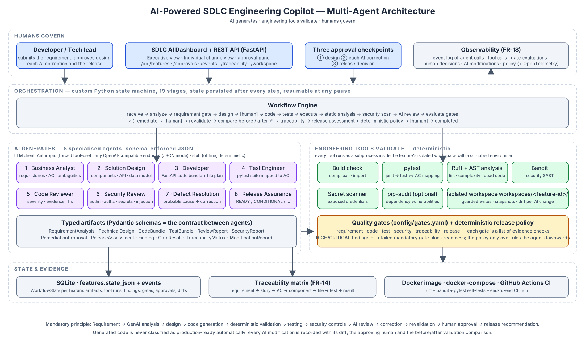

# AI-Powered SDLC Engineering Copilot — Multi-Agent Architecture

> **AI generates. Engineering tools validate. Humans govern.**

A working implementation of the *AI Engineer Hackathon* brief: a copilot that accepts an
application-development requirement and orchestrates the whole engineering lifecycle —

```
Requirement → Requirement analysis → User stories & AC → Technical design → [human approval]
→ Code generation → Test generation → Test execution → Static analysis → Security validation
→ AI code review → Quality gates → (Defect remediation → [human approval] → Revalidation)*
→ Traceability → Release-readiness assessment → [human approval]
```

Eight specialised agents produce typed artifacts; deterministic tools (pytest, Ruff, AST
analysis, Bandit, a secret scanner, optional pip-audit) validate them inside an isolated
workspace; configurable quality gates decide whether the change may progress; humans approve
the design, every AI-generated correction and the release. Everything is recorded — every
AI decision, tool call, gate evaluation, diff and human decision — and shown on an SDLC
dashboard.



---

## 1. Quick start

### Offline demo (no API key)

```bash
python -m venv .venv && source .venv/bin/activate   # Windows: .venv\Scripts\activate
pip install -r requirements.txt
cp .env.example .env                                # LLM_PROVIDER=stub by default

# a) run the reference feature from the brief end-to-end on the command line
python -m app.cli run --example --auto-approve

# b) or start the API + dashboard and drive it from the browser
uvicorn app.main:app --reload            # open http://localhost:8000
```

`LLM_PROVIDER=stub` uses a deterministic, rule-based stand-in for the model (see
[§6](#6-llm-providers-and-the-stub)); it is what the platform's own tests and CI use, and it exercises
every stage including the remediation loop.

### With a real model

```bash
# Anthropic
export LLM_PROVIDER=anthropic ANTHROPIC_API_KEY=sk-ant-...        # optional: ANTHROPIC_MODEL=...
# or any OpenAI-compatible endpoint (OpenAI, Azure gateway, vLLM, Ollama, LiteLLM ...)
export LLM_PROVIDER=openai OPENAI_API_KEY=... # optional: OPENAI_MODEL=..., OPENAI_BASE_URL=...

uvicorn app.main:app --port 8000
```

### Docker

```bash
cp .env.example .env
docker compose up --build                 # dashboard on http://localhost:8000
docker compose run --rm demo              # one-shot CLI run of the reference feature
docker compose run --rm tests             # platform self-tests inside the image
```

### Platform self-tests

```bash
pytest -q                 # 41 tests: agents, tools, gates, traceability, persistence, API, end-to-end workflow
ruff check . && bandit -q -r app -x app/llm/stub_assets -ll
```

---

## 2. Walking through the demo

Submit the example request from the brief (*"Develop an API allowing customers to update their
contact information. Validate mandatory fields, prevent unauthorized modification, maintain an
audit record and return appropriate API error responses."*) — on the dashboard, with the CLI,
or with `curl`:

```bash
curl -s -X POST localhost:8000/api/features -H 'content-type: application/json' \
  -d '{"title":"Customer contact update API","description":"Develop an API allowing customers to update their contact information. Validate mandatory fields, prevent unauthorized modification, maintain an audit record and return appropriate API error responses."}'
```

What happens:

| Step | Stage | Who | Outcome |
|---|---|---|---|
| 1–2 | `analyzing_requirement` | Business Analyst agent | 5 FRs, 4 NFRs, 3 business rules, 4 stories, 6 acceptance criteria, 4 assumptions, **4 ambiguities surfaced as questions** (not silently resolved) |
| 5 | `requirement_gate` | gate engine | AC defined for every story, ambiguities identified, mandatory NFR categories (security, audit, performance, logging) covered → **PASS** |
| 6–7 | `designing` → `awaiting_design_approval` | Solution Design agent → **human** | components, API contract, data model, validation/error/logging/security design, file plan. The dashboard shows the open questions and asks you to approve or send it back with feedback |
| 8–9 | `generating_code`, `generating_tests` | Developer + Test Engineer agents | 12 source files and a 15-test pytest suite written to `workspaces/<feature-id>/`, each test tagged with the AC it verifies |
| 10–12 | `executing_tests`, `static_analysis`, `security_validation` | pytest, build check, Ruff, AST, Bandit, secret scanner | 15/15 tests pass, build OK, 1 non-critical lint finding, **1 exposed credential (`JWT_SECRET` hard-coded)** found by the secret scanner, Bandit (B105) and the Security Review agent |
| 13–14 | `ai_code_review`, `evaluating_gates` | Code Reviewer + Security Review agents, gate engine | code ✓ test ✓ **security ✗** → routed to remediation |
| 15 | `remediating` → `awaiting_remediation_approval` | Defect Resolution agent → **human** | failure captured, probable cause identified, a full-file correction proposed, its unified diff recorded as `MOD-01` — **nothing is applied until a developer approves** |
| 16 | `revalidating` → `evaluating_gates` | all tools (+ AI reviews) re-run | before/after comparison: `findings {HIGH:2, MEDIUM:2, LOW:6} → {MEDIUM:2, LOW:4}`, tests still 15/15; secret-related findings auto-resolve because the tools no longer detect them; security gate now **PASS** |
| 17 | `traceability_check` | traceability engine | requirement→code 100 %, AC→tests 100 %, tests with results 100 % |
| 18 | `release_assessment` → `awaiting_release_approval` | Release Assurance agent + **deterministic policy** | **CONDITIONAL** (all gates green, two MEDIUM hardening findings remain and are listed as conditions) |
| 19 | `completed` / `rejected` | **human** | final release decision recorded |

Try the alternative paths too: reject the design with a comment (it is redesigned with your
feedback), reject the AI correction (the policy forces `MANUAL_REVIEW`/`NOT_READY`), or set
`remediation.require_human_approval: false` in `config/gates.yaml` to let corrections apply
automatically (still recorded and still revalidated).

---

## 3. What is in the box (deliverables)

| Deliverable | Where |
|---|---|
| Working SDLC AI application (API + dashboard + CLI) | `app/main.py`, `app/dashboard/index.html`, `app/cli.py` |
| Requirement Analysis / Technical Design / Developer / Test / Code Review / Security / Defect Remediation / Release Assurance agents | `app/agents/*.py` (one file per agent, prompts + schema) |
| Multi-agent orchestration workflow (19-stage state machine, pause/resume, remediation loop) | `app/orchestration/engine.py` |
| Code-generation capability + automated test generation and execution | `app/agents/developer.py`, `app/agents/test_engineer.py`, `app/tools/pytest_runner.py` |
| Requirement-to-code-to-test traceability | `app/orchestration/traceability.py`, `/api/features/{id}/traceability`, dashboard *Traceability* tab |
| Configurable SDLC quality gates + release policy | `config/gates.yaml`, `app/orchestration/gates.py` |
| Human approval mechanism (design, each AI correction, release) | `WorkflowEngine.approve`, `/api/features/{id}/approvals/{checkpoint}`, dashboard approval panel |
| SDLC observability dashboard (executive + individual-change views) | `GET /` , `/api/dashboard/summary`, `/api/features/{id}/events` |
| Automated tests for the platform itself | `tests/` (41 tests incl. end-to-end workflow and API) |
| Architecture diagram | `docs/architecture.svg` / `.png`, `ARCHITECTURE.md` |
| Docker deployment + CI | `Dockerfile`, `docker-compose.yml`, `.github/workflows/ci.yml` |
| README and setup documentation | this file, `ARCHITECTURE.md`, `.env.example` |

Functional-requirement coverage (FR-01 … FR-18 of the brief) is mapped in
[ARCHITECTURE.md §7](ARCHITECTURE.md#7-functional-requirement-coverage).

---

## 4. REST API

| Method & path | Purpose |
|---|---|
| `POST /api/features` `{title, description, context?, auto_run?}` (`?wait=true` to run synchronously) | FR-01 intake; starts the workflow |
| `POST /api/features/{id}/run` | resume a non-paused workflow (background unless `?wait=true`) |
| `POST /api/features/{id}/approvals/{design\|remediation\|release}` `{decision, approver, comment}` | FR-17 human decisions; the workflow resumes automatically |
| `GET /api/features` · `GET /api/features/{id}` | summaries / full change view (artifacts, tool runs, findings, gates, approvals, diffs) |
| `GET /api/features/{id}/artifacts/{name}` | one artifact in full (`code_bundle`, `review_report`, `modifications`, …) |
| `GET /api/features/{id}/events` | FR-18 event log |
| `GET /api/features/{id}/traceability` | FR-14 matrix |
| `GET /api/features/{id}/workspace[?path=]` | files in the isolated workspace |
| `GET /api/dashboard/summary` · `GET /api/gates` · `GET /api/stages` · `GET /health` | dashboard data, gate configuration, stage list |

Interactive docs: `http://localhost:8000/docs`.

---

## 5. Configuration

All settings are environment variables (see `.env.example`):

| Variable | Default | Meaning |
|---|---|---|
| `LLM_PROVIDER` | `stub` | `anthropic`, `openai` or `stub` |
| `ANTHROPIC_MODEL` / `OPENAI_MODEL` / `OPENAI_BASE_URL` | — | model and endpoint selection |
| `LLM_MAX_TOKENS`, `LLM_TEMPERATURE` | `8000`, `0.1` | generation settings |
| `SDLC_DATA_DIR` | `./data` | SQLite database (`sdlc.db`) |
| `SDLC_WORKSPACE_ROOT` | `./workspaces` | one isolated directory per feature |
| `SDLC_GATES_CONFIG` | `./config/gates.yaml` | quality-gate definitions |
| `SDLC_TOOL_TIMEOUT` | `180` | seconds per tool execution |
| `SDLC_ENABLE_PIP_AUDIT` | `false` | run `pip-audit` on generated `requirements.txt` (needs network) |
| `OTEL_EXPORTER_OTLP_ENDPOINT` | — | export stage spans via OpenTelemetry when set |

`config/gates.yaml` controls which checks each gate runs, which severities block the security
gate, which scanners are mandatory, coverage thresholds, the remediation budget
(`max_iterations`), whether AI corrections need human approval, and the release policy.

---

## 6. LLM providers and the stub

`app/llm/client.py` wraps three providers behind one call — `generate(agent, system, user, Schema)` —
that always returns a validated Pydantic object:

* **anthropic** – Messages API with *forced tool use*: the schema is passed as a tool's
  `input_schema`, so the model must emit matching JSON.
* **openai** – JSON mode with the schema in the system prompt; works with any
  OpenAI-compatible server through `OPENAI_BASE_URL`.
* **stub** – `app/llm/stub.py` returns hand-written artifacts for the reference feature. The
  generated application in `app/llm/stub_assets/contact_service` is a real FastAPI service with a
  passing test-suite and **one planted defect** (a hard-coded signing key) so the full
  detect → propose → approve → apply → revalidate loop runs offline. The stub is reactive where
  it matters: the Security Review agent only reports the secret while it is present, and the
  Defect Resolution agent only proposes the fix for that finding.

If a provider returns JSON that fails validation, the client feeds the validation errors back
once (self-repair) before failing the stage; every attempt is logged as an `agent_call` event.

---

## 7. Repository layout

```
app/
  main.py                 FastAPI app + REST API + dashboard route
  cli.py                  command-line runner (demo / CI)
  config.py               environment-driven settings
  models.py               Pydantic schemas for every artifact and the workflow state
  persistence.py          SQLite store (state + event log) and dashboard aggregation
  observability.py        event log + optional OpenTelemetry tracer
  agents/                 the eight agents (prompt + schema each)
  llm/                    provider abstraction, stub provider and its reference assets
  tools/                  isolated workspace, build check, pytest runner, ruff/AST, bandit/secrets/pip-audit
  orchestration/          state machine (engine.py), quality gates + release policy, traceability
  dashboard/index.html    executive view + individual change view
config/gates.yaml         configurable quality gates
tests/                    platform self-tests
docs/architecture.svg     architecture diagram
Dockerfile, docker-compose.yml, .github/workflows/ci.yml
```

---

## 8. Notes and limitations

* Generated code targets Python + FastAPI (one of the three stacks allowed by the brief).
  Supporting another stack means adding a tool set (build/test/lint/SAST) for it; agents and
  gates are language-agnostic.
* The workspace isolation is directory + environment scrubbing + path guarding; run the platform
  in the provided container for process-level isolation.
* `pip-audit` is optional because it needs network access to vulnerability data.
* Human approvals are recorded by name but not authenticated — put the API behind your SSO /
  gateway in a real deployment.
