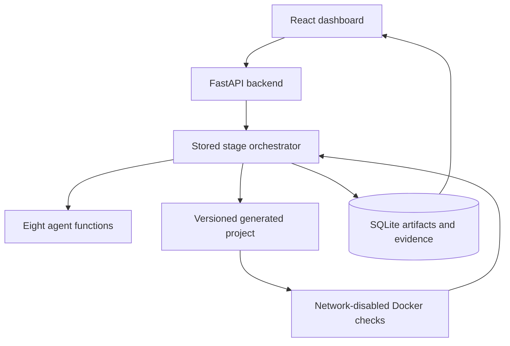

# Forge · AI SDLC workbench

One React dashboard and FastAPI backend coordinate eight specialized agents to take a small Python API from requirements to an evidence-based release report. SQLite stores runs, versioned artifacts, check evidence, findings, approvals and events. Generated projects live in isolated, versioned directories.

## Run locally

Requires Python 3.12+, uv, Node 22+, and a running Docker engine with Linux containers.

```sh
uv sync
cd frontend
npm ci
npm run build
cd ..
docker build -f runner.Dockerfile -t forge-runner:local .
uv run uvicorn backend.main:app --host 127.0.0.1 --port 8000
```

Open http://localhost:8000. API documentation: http://localhost:8000/api/docs.

For frontend development, run `npm run dev` in `frontend/` and visit http://localhost:5173. Vite proxies `/api` to the backend. Build before starting the backend to serve the production frontend from the same app.

In WSL, enable Docker Desktop integration for your distro. Alternatively launch the backend with `DOCKER_BIN=docker.exe uv run uvicorn backend.main:app --host 127.0.0.1 --port 8000`; the runner converts mount paths with `wslpath` for the Windows client.

## Demo for the judges

1. Choose **Reference demo** and load the customer-contact example. Demo agents use a clearly labeled deterministic fixture; they do not claim to call an LLM. Arbitrary feature generation uses LLM mode.
2. Analyze the requirement. Inspect REQ/AC IDs, assumptions, API design and file structure. Approve the design.
3. The Developer and Test Engineer produce a small contact API and four acceptance tests. Version 1 deliberately lacks phone-format validation.
4. Actual isolated pytest execution fails the invalid-phone acceptance criterion. Code review identifies source evidence. Inspect the checks and proposed correction.
5. Approve the correction. The app creates version 2, preserves the tests, invalidates previous execution evidence, and reruns all checks.
6. Inspect the traceability table and quality gates. Complete final human review, then download the project and full evidence JSON.

The reference finishes **CONDITIONAL**, because simulated `X-User-Id` identity and volatile storage remain explicit nonblocking limitations within the approved hackathon scope. It is not approved for production. An actual scanner failure or missing execution evidence changes the outcome; the UI never fabricates a successful run.

## LLM mode

Set `LLM_API_KEY` and `LLM_MODEL` in the backend environment, and optionally `LLM_BASE_URL` for a compatible chat-completions provider. `.env.example` lists settings; local uv does not load `.env` automatically (use `uv run --env-file .env ...`). Compose reads `.env` automatically. Credentials remain backend-only and are never passed to generated containers.

All eight agent functions have separate prompts and Pydantic contracts. The provider must support JSON-object chat responses. Agent output is validated before use. Generated APIs must use the prepared FastAPI/Pydantic/httpx environment; dependencies absent from the runner are reported as **Not executed**, with a preparation reason. Rebuild a deliberately reviewed runner image for extra dependencies, rather than allowing generated installation commands.

## Workflow and controls



The persisted stages are analysis → design approval → generation → validation → correction approval or release review → completion. Clarification answers regenerate analysis and design for another review. Approvals record the exact version and timestamp. Up to **two** approved correction rounds are allowed. Persistent failures then require manual review. Interrupted runs can resume; immutable project versions are reused only if their contents match.

Each generated-code check runs in a disposable container with networking disabled, no application secrets, nonroot UID, read-only root filesystem, dropped capabilities, no-new-privileges, 384 MB memory, one CPU, 96 process limit, 128 MB temporary filesystem, bounded output and a 90-second deadline. No generated Python executes on the host. The host is a trusted local operator environment: the backend controls Docker and is intentionally bound to localhost. Do not expose this unauthenticated hackathon control plane publicly or share its Docker socket with untrusted users. Container isolation is not a substitute for a hardened multi-tenant execution service.

Controls are compilation, pytest with JUnit evidence, Ruff, Bandit, and dependency audit. The runner image runs real `pip-audit` during dependency preparation with networking available. Runtime verifies the installed inventory against that immutable audit snapshot and checks its age (maximum seven days). Rebuild with `--no-cache` to refresh vulnerability data. Missing, stale or unsuccessful audit evidence is not displayed as passed. Every check records command, exit status and output. Optional policy `REQUIRE_DEPENDENCY_AUDIT=false` relaxes only that gate; it does not mark a missing audit as passed.

Backend rules determine the release recommendation. Failed mandatory controls or unresolved high/critical findings produce **NOT READY**. Missing checks, traceability or required approvals produce **MANUAL REVIEW**. Passing mandatory gates and approvals produce **READY**, or **CONDITIONAL** when nonblocking findings remain. The Release Agent explains the computed decision and cannot override it. Only current code-version execution evidence is used; the approved design remains valid across corrections that preserve that design. Test mappings are matched against actual JUnit node IDs.

## Docker deployment

On a Linux Docker host or WSL with Docker integration:

```sh
docker build -f runner.Dockerfile -t forge-runner:local .
docker compose up --build
```

Compose mounts the Docker socket and generated project directory at matching host/container absolute paths so isolated checks can bind the project. Run Compose from this repository with `PWD` set to its absolute Linux path. The app is available on http://localhost:8000. Persisted data is in `data/`; project versions are in `generated_projects/`.

## Verify

```sh
uv run pytest -q
uv run ruff check backend tests
cd frontend
npm run typecheck
npm run build
```

Platform tests cover path confinement, runner controls, gate precedence, stale approvals, approval pauses, correction versioning and missing-tool behavior. Mocked tool evidence in platform tests is explicitly separate from the real Docker demo. A live LLM run additionally requires your configured provider credentials.

With the backend running, `uv run python scripts/verify_demo.py` exercises the real HTTP workflow and Docker checks, including all three human-control actions on a new reference run. It asserts the initial pytest failure, corrected version's five passing checks, all four criterion executions, and final conditional recommendation.

## Structure

`backend/agents/` contains Analyst, Designer, Developer, Test Engineer, Reviewer, Security, Fix and Release agents. `backend/services/` contains inference, workspace confinement, Docker execution and gate policy. `backend/orchestrator.py` controls stage transitions; `backend/models.py` owns request contracts and SQLite persistence. `frontend/` contains all three screens.
